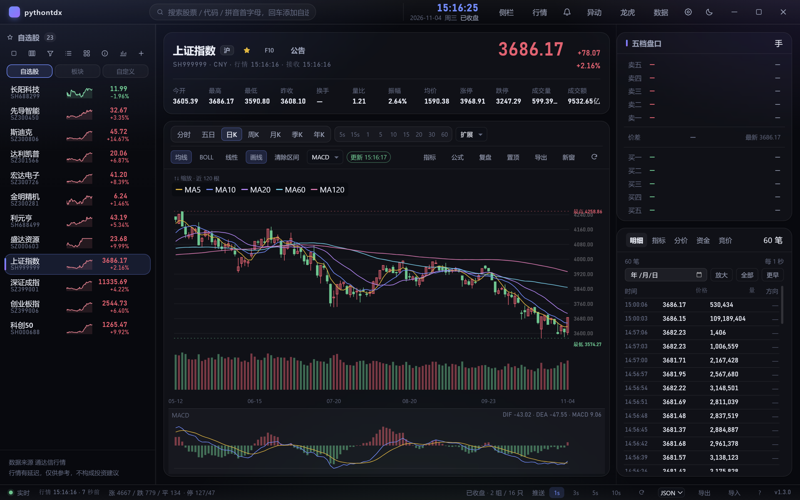
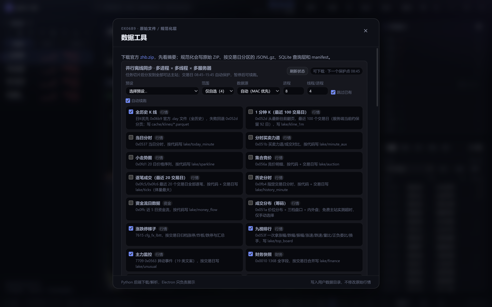
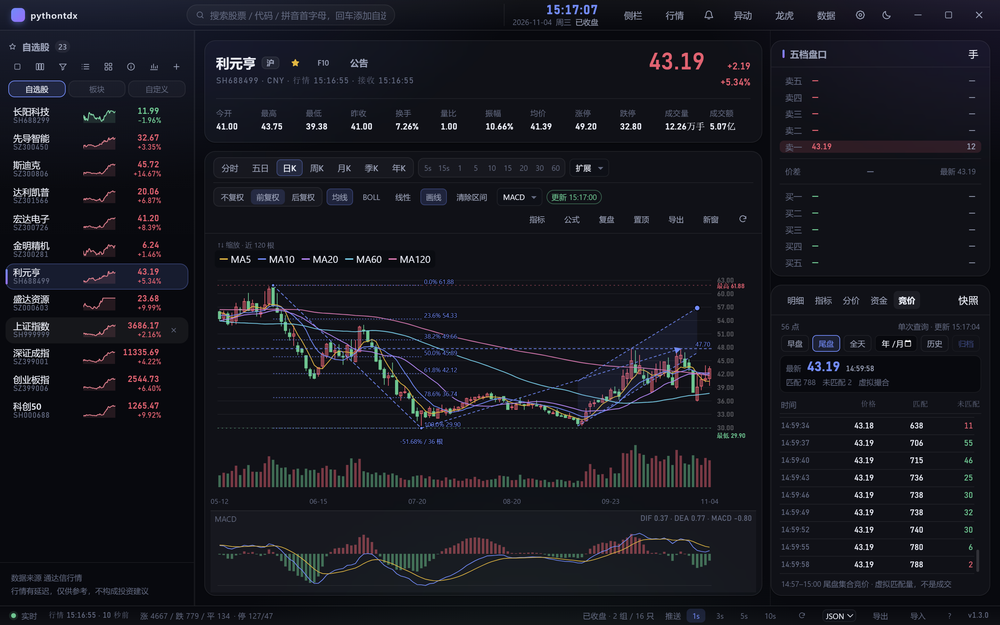

# pythontdx

**只做 A 股、只接通达信行情源**的跨平台行情终端。Electron 桌面端与浏览器 Web 端共用
一套 SolidJS 界面，Python 负责通达信协议、实时行情、离线数据与面向机器学习的数据湖。

`Electron` · `Vite` · `SolidJS` · `TypeScript` · `Python` · `7709 / MAC / 7615`

**v1.4.0** · GPL-3.0-or-later · Windows x64 / macOS arm64 / Linux x64

`npm run check` **359 TS（357 通过 / 2 skipped）+ 283 Python（282 通过 / 1 skipped）**

[GitHub Releases](https://github.com/riverzhou/pythontdx/releases) ·
[数据并行同步](docs/18-离线数据并行同步.md) ·
[协议总表](docs/21-通达信协议总表.md) ·
[MAC 策略](docs/19-MAC协议与数据源策略.md)

---

## 一眼看懂



- **实时行情**：1 秒刷新；分时、五日、K 线、九宫格同一节奏；
- **数据工具**：24 个离线数据集，日 K 与 1 分钟 K 独立勾选，多进程 × 多线程 × 多服务器并行；
- **协议覆盖**：7709 主站 29 条命令、MAC 15 条 A 股相关命令、7615 51 个入口；
- **本地数据湖**：Parquet/ZSTD + DuckDB、JSONL.gz、`trade_date=` 分区、manifest + SHA256；
- **桌面 + Web**：同一套渲染层，桌面走 IPC，Web 走 HTTP/SSE/WebSocket。

## 1.4.0 重点：离线 K 线下载重做

- **日 K 走官方文件**：`0x06b9` 直接下载 `vipdoc/{sh,sz,bj}/lday/<code>.day`，
  失败才回退 0x052d 分页；600519 实测 6,035 根全历史 / 7 个块，100 只 16×4 约 6.2 秒。
- **1 分钟 K 100 日窗口**：独立 `kline_1m` 数据集，优先复用本地缓存，只补最新页；
  服务端实际保留约 92 个交易日（600519 实测 22,080 根）。
- **Parquet 写入提速**：临时 CSV staging + DuckDB `COPY`，2.2 万行约 4 秒降到
  **0.19 秒/文件**；最终仍是 Parquet+ZSTD+manifest，CSV 写完即删。
- **真正跳过已有数据**：1m/manifest/auction/money_flow/日 K 都有明确的跳过规则；
  “服务器明确无数据”写 `.nodata.json`，第二次同步不再重试；北交所旧 `.day`
  当天只刷新一次，避免同一天反复重下。
- **任务摘要/续跑**：保留 `completed/failed/incomplete/cancelled`、完成/失败/行数/
  总耗时；中断可一键续跑，自动续跑默认开启，同一 jobId 只自动尝试一次。
- **官方 1 分钟没有 HTTP URL**：7719 文件服务对 `.lc1` 返回 `size=0`；官方客户端
  是行情协议抓取后写 `vipdoc/*/minline/*.lc1`，本项目继续走 0x052d。

---

## 截图

### 主图：指数 K 线、成交量、盘口


主图上方是今开/最高/最低/昨收、换手、量比、振幅、均价、涨停/跌停、成交量/成交额；
右侧五档盘口 + 明细/指标/分价/资金/竞价页签；下方成交量与 MACD 副图。
指数成交量已统一成「手」，与 K 线同单位。

### 多股同列：九宫格分时 / K 线


- 固定 3×3，默认全天分时（240 个交易分钟固定横轴）；
- 可切日/周/月/60/30/15/5/1 分；
- 自选/自定义超过 9 只自动分页，卡片可拖动调整九格布局，点击卡片切主图。

### 全市场列表


20 列：代码/名称/现价/涨跌幅/成交额/换手/量比/涨速 + 今开/最高/最低/昨收/成交量/
均价/振幅/涨停/跌停/总市值/流通市值/迷你走势；1440×900 下无横向滚动。

### 排行榜与板块


排行榜复用同一套指标列；板块/概念左侧板块栏 + 成分股表，迷你走势按可见行懒加载。

### F10：目录 + 在线页签


16 段目录、19 个在线页签；固定 1056px 阅读宽度，正文/表格/公告链接/GBK 原文按段落渲染；
个股结果自动写 point-in-time 快照。

### 数据工具：并行同步 + 真实进度



- 默认 **8 进程 × 4 线程**，可调 1–48 × 1–4；一进程钉一台主站，48×4 = 192 条连接；
- 日 K（全历史，官方 `.day` 文件）与 1 分钟 K（最近 100 交易日）是两个独立选项；
- 逐笔成交默认最近 **20 个交易日**；
- 数据集、范围、数据源、进程/线程、跳过已有、自动续跑会持久化；
- 每个耗时操作都有进度条：探测/计划/完成数/吞吐/ETA、下载 zhb.zip、扫描/校验、
  备份/恢复字节进度、K 线导出、全市场快照、数据湖归档、本地导入/写回；
- 最近任务摘要显示完成/跳过/失败/行数/总耗时，中断任务可单独续跑；
- 08:45–15:45 自动保护：窗口内启动返回 `blocked`，跑到一半暂停，15:45 后续跑。

### 尾盘集合竞价



「竞价」页签支持 **早盘 / 尾盘 / 全天**：

- 早盘 09:15–09:25；
- 尾盘 14:57–15:00（`0x056a selector=1`）；
- 全天合并；虚拟匹配量不是正式成交，15:00 最终成交看「明细」。

---

## 数据下载与缓存

### 并行模型

```text
父进程探活全部主站 → 拉一次代码表 → 按数据集/代码/日期切片
  → N 个 worker（每进程钉一台主站）
      → 每 worker T 条线程（每条独立 7709 连接）
```

- 开发态与打包态共用 `offline_sync.py --worker` / `tdx-bridge --offline-worker`；
- 任务级断点续跑：有效的同名归档直接跳过，损坏副本才允许重写；
- worker 每 1.5 秒原子写进度，父进程只读文件，不阻塞状态查询；
- Windows 看门狗用 `OpenProcess + WaitForSingleObject`，不会误发 Ctrl+C。

### 跳过规则（1.4.0 修正）

| 数据 | 规则 |
| --- | --- |
| 日 K | 缓存 manifest 有效；当天已刷新但官方仍是旧日期的北交所/停牌代码，当天跳过，次日再试 |
| 1 分钟 K | 当前 `trade_date` 分区有文件 + manifest + rows；旧 `complete=false` 也跳过 |
| 逐笔 | `trade_date=<day>/<code>.parquet` + manifest + rows/bytes |
| auction | 专用 manifest（SHA 是解压后 JSONL）按 rows/code/date 校验 |
| money_flow | 旧 manifest 无 rows，按 code/date/bytes 校验 |
| 明确无数据 | 写 `.nodata.json`，下次同代码/日期跳过；只标记 no-data，不标记超时 |

规划阶段不对十几万份逐笔逐个读全文件算 SHA；完整计划约 **6–7 秒**。

### 实测

```text
1m 100 只：48×4 8.2s / 8×4 12.3s
日K 100 只：16×4 6.2s / 48×4 12.2s
```

这台 8 核/16 线程机器上，48 进程不总是更快；默认 8×4 更稳。

---

## 功能

### 行情与图表

- 7709 实时快照/增量刷新，MAC 批量报价兜底；
- 分时 / 五日 / 多周期 K：5s、15s、1–60 分钟、2–45 日、日/周/月/季/年；
- 五档盘口、逐笔、分价、集合竞价、资金流；
- 均线、BOLL、成交量、MACD/KDJ/RSI 等副图；线性/对数坐标；
- 缩放、平移、十字光标、区间统计；
- 画线：趋势线/水平线/垂直线/文字/斐波那契/测量/箭头/平行通道，
  吸附、拖动、复制粘贴、撤销/重做、按复权隔离、日期锚点持久化；
- 多股同列、独立分时窗口、全屏自选、置顶。

### 资料、选股与复盘

- F10：16 段目录、19 个在线页签；
- 左栏「自选股 / 板块 / 自定义」三视图，自选/自定义可拖拽排序；
- 排行榜：涨幅/成交额/涨速/换手/量比/市值/资金流等；
- 条件选股、预设、自动股票池、公式选股、单标的/组合回测；
- 复盘：日 K 逐根、分时逐分钟、历史逐笔回放；
- 离线数据单文件备份/恢复；备份/恢复有真实字节/文件进度。

### 数据与协议

- **7709**：29 条命令；K 线、分时、逐笔、竞价、财务、F10、文件、代码表；
- **MAC**：15 条 A 股相关命令；报价/K 线/分时/逐笔/竞价/板块/资金流/文件元信息；
- **7615**：51 个 `fetch_*`、9/9 HQServ 页、20 个行业子页、84 个资讯频道、涨跌停梯子；
- **gpcw 历史财务**：5,572 只 × 658 float，写 `lake/finance_history`；
- **本地 GBBQ**：本机 202,313 条，解密后写 `lake/gbbq`；
- **归档去重**：按 `trade_date` 或「代码/业务 key」分片，合法同名归档保留第一版，
  只有损坏副本才允许重写；
- **并发安全**：分区级文件锁 + 唯一临时文件 + 原子替换；
- **窗口保护**：交易日 08:45–15:45 不下载离线数据，实时查询不受影响。

> MAC 不是 7709 超集：没有代码表/F10/136B 财务/股本变迁/特殊涨跌停/退市/九榜；
> 采用 MAC 优先 + 7709 兜底。0x1217 文件分片已实现，但测试主机返回空分片，
> 生产下载仍走 0x06b9。边界见 [docs/19](docs/19-MAC协议与数据源策略.md)。

---

## 数据湖

```text
~/.local/share/pythontdx/data/
  raw/tdx/                 原始 ZIP / 文件
  cache/klines/            K 线 Parquet + manifest
  lake/
    today_minute/          分时（按代码分片）
    ticks/                 逐笔 Parquet（最近 20 交易日）
    auction/               竞价
    money_flow/            资金流
    category_quotes/       分类行情
    top_board/             九榜
    unusual/               主力监控
    finance/               136B 财务快照
    corporate/             股本变迁
    finance_history/       gpcw 历史财务
    gbbq/                  本地 GBBQ
    blocks/                板块与行业
    limit_ladder/          涨跌停梯子
    f10_pit/               F10 快照（point-in-time）
    server_files/          服务器文件清单
  exports/                 导出 CSV/JSON/Parquet
```

每份归档带 manifest（来源、时间、行数、SHA256、文件列表）；
`data_coverage` 扫描覆盖，`data_integrity` 逐份校验 manifest/SHA256。
**正常显示问题不需要重新下载历史数据**——缓存有校验，只有损坏副本才允许重写。
1.4.0 对“有 parquet 无 manifest”的旧 1m 文件会读回补 manifest，不整只重抓。

---

## 快速开始

### 依赖

- Node.js ≥ 20.19（实测 24.x）
- Python ≥ 3.10（开发/后端；打包版用户不需要）
- duckdb、pyarrow/pandas/numpy、Nuitka（构建 sidecar 时需要）

### 开发

```bash
npm install
python -m pip install -r requirements.txt

npm run dev          # 桌面：Electron + Vite + Python
```

Web：

```bash
python python/tdx_server.py --port 8765
npm run dev:web
```

### 检查与构建

```bash
npm run check        # 类型 + Lint + TS 测试 + Python 测试
npm run build        # Electron 生产构建
npm run build:web    # Web 产物 out/web
npm run build:win    # Windows 安装包/便携版/绿色 zip
npm run build:linux  # AppImage + deb
npm run build:mac    # macOS arm64 dmg
```

发布产物在 `release/<version>/`；打 tag 后 GitHub Actions 构建三平台并上传 Release。

---

## 项目结构

```text
src/main/        桌面壳：窗口/托盘/更新/拉起 Python sidecar
src/preload/     contextBridge 白名单
src/shared/      桌面/Web/后端共享类型与纯函数
src/renderer/    SolidJS 界面（桌面与 Web 共用）
python/          通达信协议 + Python 服务/数据任务
scripts/         图标、截图、Python 入口、协议探针
docs/            是什么、为什么、协议与发布记录
```

新代码位置：

- 新协议/字段解析 → `python/tdx_bridge.py` + `python/test_tdx.py` + fixture；
- 主机探活/落盘/补历史 → `python/`；
- 桌面/Web 共用界面 → `src/renderer/`；
- 平台外壳 → `src/main/`；
- 全局状态 → `src/renderer/src/stores/`；
- 颜色/间距/动效 → `src/renderer/src/styles/tokens.css`。

---

## 文档

| 文档 | 内容 |
| --- | --- |
| [docs/00-项目章程](docs/00-项目章程.md) | 目标、范围、六条核心要求 |
| [docs/02-架构](docs/02-架构.md) | 双前端、Python sidecar、数据流 |
| [docs/03-通达信协议](docs/03-通达信协议.md) | 7709/MAC/7615 字段与报文 |
| [docs/08-通达信资料索引](docs/08-通达信资料索引.md) | 协议来源、探针、研究台账 |
| [docs/12-数据覆盖审计](docs/12-数据覆盖审计.md) | 每个数据集的实际覆盖与边界 |
| [docs/18-离线数据并行同步](docs/18-离线数据并行同步.md) | 多进程/多线程、缓存、1m、性能 |
| [docs/19-MAC协议与数据源策略](docs/19-MAC协议与数据源策略.md) | MAC 覆盖与回退 |
| [docs/21-通达信协议总表](docs/21-通达信协议总表.md) | 命令/入口/字段总表 |
| [CHANGELOG.md](CHANGELOG.md) | 版本变更 |
| [RELEASE_NOTES-1.4.0.md](RELEASE_NOTES-1.4.0.md) | 1.4.0 发布说明 |

---

## 边界

- 只做 A 股 + 通达信；7727/EX、港股/美股/期货不做。
- `ticks`/`history_minute` 全市场是天量数据，默认只对自选或最近窗口；
  全市场需要显式确认磁盘空间。
- `f10` 的 `full` 档每只约 30 次 7615 请求，全市场首次建库以小时计；默认 `core`。
- 7615 没有公开并发/限流文档，线程数过大可能被限流；失败会在下次续跑。
- 退市代码不在当前代码表里，`delisted` 必须显式提供代码。
- `volume_profile`（0x051a）在免费主站全部超时，不进预设。
- 节假日表缺省只按周末判断；需要精确判断时在数据目录放 `trading_holidays.json`。
