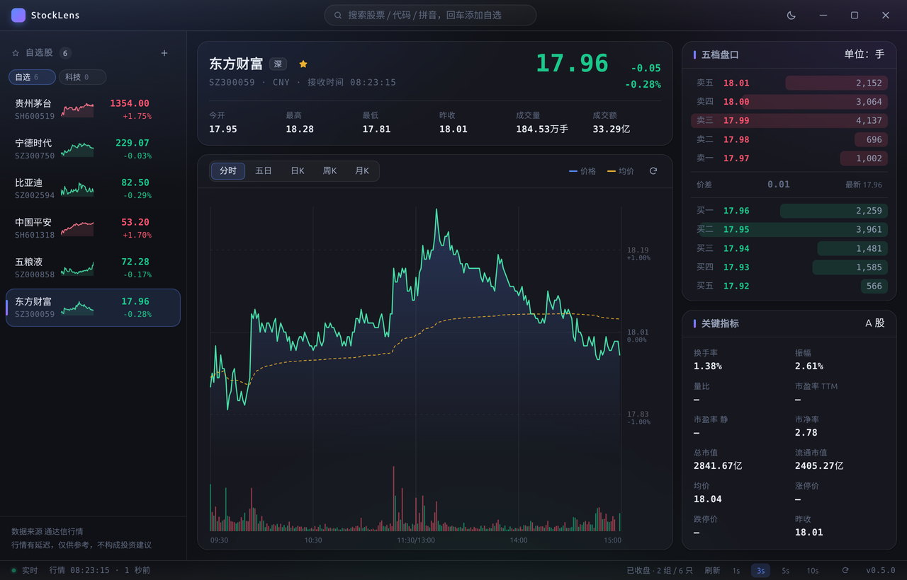

# StockLens · A 股行情终端

> 从 0 开始手写的 **A 股**行情终端。桌面用 Electron，浏览器用 Web，两者共用一套
> SolidJS 界面；数据层是 Python 后端，直连**通达信 7709**。
> 目标不只是「能看盘」，而是把实时行情、离线数据和机器学习需要的数据链路打通。

`Electron` · `Vite` · `SolidJS` · `TypeScript` · `Python` · `通达信 7709`

**当前状态**：v0.6 桌面版可用（源码验证通过，PyInstaller 打包待实测）；
v0.7 双前端 + Python 服务化**规划中**。
`npm run check` 全绿：**177 个 TS 测试 + 78 个 Python 协议/服务测试（2 skipped）**。

<p align="center">
  
</p>

> 深色主题 · 1280×820 · 实际运行截图。截图只用于展示，不作为视觉回归基准。

> **定位：学习项目。** 代码质量与可读性优先于功能数量；
> 每引入一个依赖、每写一段复杂逻辑，都要能说清「为什么」。
> 目标、范围与非目标见 **[docs/00-项目章程.md](docs/00-项目章程.md)**。

---

## 🎯 目标

| #   | 目标                 | 一句话                                                         |
| --- | -------------------- | -------------------------------------------------------------- |
| G1  | 双前端 + Python 后端 | Electron 与 Web 共用一套界面，数据只由一个后端提供             |
| G2  | 只用通达信数据源     | 7709 / MAC / 7615 / 文件下载 / 本地文件；实时 + 离线 + 可做 ML |
| G3  | 只做 A 股            | 沪/深/北 A 股；港股、美股、期货、期权、外汇明确不做            |
| G4  | 对齐官方客户端       | 行情、分析、选股、资料、数据管理尽量对齐，操作习惯也要像       |
| G5  | 精致好看             | 设计令牌、一屏无滚动条、桌面/Web 一致、手感可验收              |
| G6  | 先查证再实现         | 网络研究 + 真实报文验证；来源登记，验证不了就明说              |

> 详细解释、功能矩阵与成功标准见 [docs/00-项目章程.md](docs/00-项目章程.md)。

---

## ✅ 现在能做什么（v0.6 桌面版）

**行情与图表**

- 实时快照：多股批量拉取、主进程推送、价格跳变高亮
- 分时图：面积渐变、均价线、成交量柱、十字光标、价格/涨跌幅双轴
- 五日分时：按交易日分段上色、日期轴、日内分隔线
- K 线：5s/15s + 1/5/15/30/60 分钟 + 日/周/月/季/年，蜡烛图 + MA5/10/20 + 成交量 + 浮层读数；主图 BOLL 叠加 + MACD/KDJ/RSI 副图 + 线性/对数坐标、区间统计、水平线/趋势线（持久化）、技术指标面板（参数可编辑、跨重启记忆）；周期/复权口径跨重启记忆
  - `↑↓` / 滚轮缩放可见根数（以光标那一根为锚点，档位跨重启记忆）
  - `←→` 移动十字光标，`End` 回最新，`Esc` 收起
  - **指针停在图上就能用键盘**，不必先点一下
- 五档盘口：挂单量占比条；只做 A 股五档
- 成交明细、分价表（当日/历史，大单门槛）：右侧栏「五档 / 成交」切换，最近 60 笔、3 秒刷新，支持历史日期与「更早」翻页
- 资金流：右侧栏「资金流」页签，最近 5 日主力/主买净额与占比
- 集合竞价：右侧栏「竞价」页签，当日过程快照（虚拟匹配量/未匹配量）
- 公式预览：安全表达式 MA/EMA/REF/ABS/MAX/MIN/CROSS，叠加收盘价曲线，可保存/应用、做单标的回测（收盘到收盘、年化/胜率/回撤）+ 自选池等权组合回测（含净值曲线）并筛选当前自选池
- 条件选股：价格/涨幅/成交额/换手/振幅 + 行业扫描；公式选股支持成交额前 N/全市场，分块进度/取消（后端安全表达式；全市场约 99 秒）
- 复盘：日 K 逐根 / 当日分时逐分钟 / 当日/历史逐笔前进与播放，只把当前位置之前的切片喂给图表
- 行情预警：价格/涨幅/量比/换手/振幅本地规则，同日同规则只提示一次，应用内 toast + 系统通知
- 板块/概念/行业：行业 111、概念 269、风格 161、指数 117、一般 100；左栏分类、右栏成分股 + 880xxx 指数报价/K线，点击切股
- F10 公司资料：标题栏 F10 按钮，7709 目录 + GBK 正文，左目录右正文；另接 7615 在线公告/新闻/公司概况/估值/财务指标/主营构成/十大股东/研报列表/两融大宗/三大报表关键科目/全部原始列
- 排行榜：涨幅 / 成交额 / 涨速 / 短换手 / 封单额，服务端排序首屏 80 条、可加载更多，点击行查看
- 关键指标：换手率、振幅、市净率、市值；PE TTM / 量比 / 涨跌停暂缺
- 交易时段感知：盘后自动降频到 30s+，窗口不可见时暂停请求

**自选与交互**

- 多分组自选：新建 / 双击改名 / 删除（股票自动并入其它分组，不丢数据）
- 拖拽排序：组内拖动改顺序，拖到分组标签上完成跨组移动
- 行内迷你走势图：当日分时，和旁边涨跌幅同源同色
- 搜索联想：240ms 防抖、键盘上下选择、支持拼音 / 中文 / 纯代码直加（桌面与 Web 共用）
- 十字光标读数与图表标题区联动

**工程**

- 类型契约桌面 / Web / 后端共享，改错立刻编译报错
- 多股同列：当前分组最多 6 只，日 K / 当日分时迷你图，点击切换主图
- 自选导入/导出：状态栏 JSON 备份，导入追加分组、ID 冲突自动改名
- 数据工具：标题栏「数据」弹窗，下载 `zhb.zip` 摘要，导出 JSONL.gz / CSV / SQLite / manifest，并对 stats.db 做只读 SQL 查询；Parquet/DuckDB 为可选数据湖组件（已实测，默认不装）
- 只读 HTTP API（`python/tdx_server.py`）+ Web 只读前端（`src/web`，复用同一套 SolidJS 渲染层）；SSE/WebSocket 行情流已接，`--web-dir out/web` 可单端口托管
- 177 个 TS 单元测试 + 78 个 Python 协议/服务测试（真实报文 fixture + 图表几何）
- `npm run shot` 一键截图验收界面（可注入点击 / 聚焦 / 按键）
- 数据 v1 → v2 结构迁移（扁平自选股 → 分组），用户无感知
- 深 / 浅双主题，全部颜色收在一份设计令牌里
- 单文件便携版 exe + NSIS 安装包，PyInstaller 桥接进程随包分发

**还没做（规划中）**

| 阶段 | 内容                                                          |
| ---- | ------------------------------------------------------------- |
| v0.7 | Web 只读页 + SSE + 单端口托管 + 拼音搜索已落地；WebSocket/写操作、主机 `connect.cfg` + 探活待补 |
| v0.8 | 离线数据 + 数据湖（官方 zip、本地文件、Parquet/DuckDB）       |
| v0.9 | 逐笔/集合竞价、板块/排行/资金流、F10、预警、选股、复盘/多窗口 |
| v1.0 | A 股协议全覆盖、双端稳定、数据可复现                          |

完整矩阵见 [docs/05-开发路线图.md](docs/05-开发路线图.md)，
协议缺口见 [docs/08-通达信资料索引.md](docs/08-通达信资料索引.md)。

---

## 🏗 架构

**现在（v0.6）**：Electron 桌面 + Python sidecar。

```
Renderer (SolidJS) ── window.api ── Main (Node) ── JSONL ── Python sidecar ── 7709
```

**目标（v0.7+）**：桌面与浏览器共用界面，Python 后端统一提供数据。

```
Electron 壳 ─┐
             ├── HTTP / WebSocket ── Python 后端 ── 7709 / 7615 / 文件 / 数据湖
浏览器 Web ──┘
```

- 只有 Python 碰行情 socket 与文件；
- 桌面和 Web 共用 `src/renderer`、`src/shared` 与设计令牌；
- 同一台机器只允许一个后端实例，避免限流与数据分叉。

详见 [docs/02-架构设计.md](docs/02-架构设计.md)。

---

## 🚀 快速开始

```bash
# 1. 安装依赖（国内网络会自动走 npmmirror 镜像下载 Electron）
npm install

# 2. 启动桌面开发模式（主进程重启 + 渲染层热更新 + Python 桥接）
npm run dev

# 3. 打包（Windows 为例）
npm run build:win     # 或 build:mac / build:linux
```

**环境要求**

| 依赖        | 版本    | 用途                                  |
| ----------- | ------- | ------------------------------------- |
| Node.js     | ≥ 20.19 | 推荐 22 LTS 或更高                    |
| npm         | ≥ 10    | 随 Node 安装                          |
| Python      | ≥ 3.10  | 开发/打包需要；运行桌面版 exe 不需要  |
| PyInstaller | 最新版  | 仅打包需要：`pip install pyinstaller` |

> **Web 端尚未提供。** v0.7 才会加入 Web 端与服务端的开发命令（脚本名待定）；
> 在脚本真正落地前，不要按计划中的命令操作。

> **Windows**：如果 PowerShell 提示 `npm.ps1 cannot be loaded`，
> 改用 `npm.cmd install`，或执行
> `Set-ExecutionPolicy -Scope CurrentUser RemoteSigned` 后重开终端。

---

## 🛠 常用命令

| 命令                        | 作用                                                |
| --------------------------- | --------------------------------------------------- |
| `npm run dev`               | 开发模式（主进程重启 + 渲染层热更新 + Python 桥接） |
| `python3 python/tdx_server.py --port 8765` | 只读 HTTP API（Web 端数据入口）          |
| `python3 python/tdx_server.py --web-dir out/web` | 单端口托管 Web 静态页 + API + SSE |
| `npm run dev:web`           | Web 只读前端（需先起 HTTP API，默认 5174）          |
| `npm run build:web`         | 构建 Web 产物到 `out/web/`                          |
| `npm run check`             | 类型检查 + Lint + TS 测试 + Python 测试，一条命令   |
| `npm run test`              | Vitest（173 个 TS 用例）                            |
| `npm run test:python`       | Python 协议/HTTP 测试（78 个用例，真实 fixture）    |
| `npm run build:python`      | PyInstaller 打行情桥接单文件（打包前必跑）          |
| `npm run shot`              | 构建后启动应用并截图到 `screenshots/`，用于肉眼验收 |
| `npm run lint` / `lint:fix` | ESLint（含 Solid 响应式规则）                       |
| `npm run format`            | Prettier 格式化                                     |
| `npm run icon`              | 重新生成应用图标（纯 Node 手写 PNG/ICO）            |

---

## 📦 打包

```bash
pip install pyinstaller        # 只需一次
npm run build:win              # 安装包 + 单文件便携版
npm run build:win:portable     # 只要单文件便携版
npm run build:win:setup        # 只要 NSIS 安装包
npm run build:mac              # macOS dmg（需在 macOS 上执行）
npm run build:linux            # Linux AppImage / deb
```

产物在 `release/<版本号>/`。Windows 两种形态（**0.5.0 实测数据**，v0.6 待复测）：

|      | 单文件便携版                 | NSIS 安装包     |
| ---- | ---------------------------- | --------------- |
| 文件 | 一个 exe，约 106 MB          | 安装后约 368 MB |
| 安装 | 不需要，双击即用             | 需要，可选目录  |
| 启动 | 约 2 秒（每次解压约 368 MB） | 约 1 秒         |
| 卸载 | 删 exe + 数据目录            | 走卸载程序      |

> 便携版把数据写在 exe 旁边（只读位置回退到 `%APPDATA%`），
> 拷走 exe + `StockLens-data/` 就等于带走自选股。
> 完整流程、判定标准与故障速查见 [docs/07-手动编译发布手册.md](docs/07-手动编译发布手册.md)。

---

## 📡 数据与协议

- **数据源**：通达信 7709 行情主站。当前实现 8 个命令：握手、代码表/数量、
  五档、K 线、分时、历史分时、财务。
- **主机列表**：代码里 5 个 IP 只是**临时种子**（2026-10-30 实测可用）。
  目标是「客户端 `connect.cfg` → 带日期种子 → 真实业务命令探活 → 用户覆盖」，
  不维护会过期的静态列表；详见 [docs/08](docs/08-通达信资料索引.md)。
- **下一步协议**：`0x0547` 增量推送 + `0x054c` 快照（实时主链路）、
  `0x054b` 分类行情、`0x0fc5/0x0fc6` 逐笔、`0x056a` 集合竞价、`0x06b9` 文件下载。
- **离线数据**：官方 `hsjday.zip` / `tdxfin.zip` / `tdxgp.zip`，加上本地
  `.day/.lc1/.lc5`、板块、GBBQ、历史财务；目标是用 Parquet + DuckDB 落成数据湖。
- **面向 ML**：原始层不可变 → Parquet 规范化层（按 `trade_date` 分区）→ 特征层；
  财务/公告 point-in-time，保留退市证券，数据集可追溯、可重放。

> 只做 A 股。港股、美股、期货、期权、外汇不在范围；7727 扩展行情也不接入。
> 所有协议结论都要有真实报文/探针证据，不靠记忆猜字段。

---

## 🗺 路线图

| 版本 | 主题                                                      | 状态                    |
| ---- | --------------------------------------------------------- | ----------------------- |
| v0.5 | K 线缩放/光标/档位记忆                                    | ✅ 已发布               |
| v0.6 | 行情层切通达信 7709（Python sidecar）                     | ✅ 源码验证；打包待实测 |
| v0.7 | 双前端 + Python HTTP/WS 服务 + 主机策略                   | ⬜ 规划中               |
| v0.8 | 离线数据 + 数据湖（官方 zip、本地文件、Parquet/DuckDB）   | ⬜ 规划中               |
| v0.9 | 逐笔/竞价、板块/排行/资金流、F10、预警、选股、复盘/多窗口 | ⬜ 规划中               |
| v1.0 | A 股协议全覆盖 + 双端稳定 + 数据可复现                    | ⬜ 目标                 |

详细任务与依赖见 [PLAN.md](PLAN.md) 和 [docs/05](docs/05-开发路线图.md)。

---

## 🧪 工程与质量

- **提交门禁**：`npm run check` = 类型检查 + ESLint + TS 测试 + Python 测试。
- **视觉门禁**：视觉改动必须 `npm run shot` 截图；Web 端后续补浏览器截图，
  桌面/Web 同屏对比。
- **协议门禁**：新字段要有真实 fixture；来源登记到 `docs/08`，字段表回写 `docs/03`。
- **数据门禁**：规范化层有 schema 版本；抽样对照、幂等补齐、可重放。
- **已知限制**：PyInstaller 打包与 Windows/macOS 实机尚未验证；PE TTM/量比/涨跌停暂缺；
  行情时间暂用接收时间（`serverTimeRaw` 语义未确认）；没有 CI，验证靠本地手跑。

---

## 📁 目录结构

```
src/
├── main/                  # 桌面壳：窗口、持久化、轮询（迁移期）、IPC
│   ├── index.ts           #   应用入口与生命周期
│   ├── window.ts          #   无边框窗口创建与几何状态
│   ├── capture.ts         #   截图工具（npm run shot 用）
│   ├── ipc.ts             #   IPC 处理器注册中心
│   └── services/
│       ├── cache.ts       #   TTL 缓存 + 同 key 并发合并
│       ├── store.ts       #   JSON 持久化（防抖 + 原子写 + 版本迁移）
│       ├── poller.ts      #   行情轮询与推送
│       └── tdx/           #   通达信门面 + Python 桥接管理（搜索在 shared/search）
├── preload/               # contextBridge 白名单桥
├── shared/                # 桌面 / Web / 后端共享类型与纯函数（禁止平台 API）
└── renderer/              # 桌面与 Web 共用的 SolidJS 界面
    └── src/
        ├── App.tsx        #   三栏布局与订阅启动
        ├── components/    #   手绘 SVG 图表、盘口、自选等
        ├── stores/        #   Solid Store 状态仓库
        ├── lib/           #   组合式工具（尺寸、闪烁、错误文案）
        └── styles/        #   设计令牌与样式

python/
├── tdx_bridge.py          # 7709 协议 + JSON Lines 服务（仅标准库）
├── test_tdx.py            # 真实报文 fixture 的协议测试
├── build.py               # PyInstaller 单文件打包
├── fixtures/              # 实盘抓包（hex）
└── README.md              # 调试 / 测试 / 打包说明

scripts/                   # 图标、截图、Python 入口、协议探针
docs/                      # 目标、架构、协议、UI、路线图、踩坑、发布
```

> 这是 **v0.6 现状**。v0.7 会新增 Web 入口与 Python HTTP/WS 服务，
> 目录调整以 [PLAN.md](PLAN.md) 为准；不要提前按目标结构写代码。

---

## 📚 文档

| 文档                                                       | 内容                                        |
| ---------------------------------------------------------- | ------------------------------------------- |
| [docs/00-项目章程.md](docs/00-项目章程.md)                 | 六条目标、范围、目标架构、数据/ML、成功标准 |
| [docs/01-快速开始.md](docs/01-快速开始.md)                 | 环境、命令、目录、调试                      |
| [docs/02-架构设计.md](docs/02-架构设计.md)                 | 现状 v0.6 + 目标 v0.7 架构                  |
| [docs/03-通达信行情手册.md](docs/03-通达信行情手册.md)     | 7709 帧、字段表、主机策略                   |
| [docs/04-UI设计系统.md](docs/04-UI设计系统.md)             | 设计令牌、配色、排版、动效                  |
| [docs/05-开发路线图.md](docs/05-开发路线图.md)             | 里程碑、功能对齐矩阵                        |
| [docs/06-踩坑笔记.md](docs/06-踩坑笔记.md)                 | 31 个真实踩坑记录                           |
| [docs/07-手动编译发布手册.md](docs/07-手动编译发布手册.md) | 桌面端发布流程与验收                        |
| [docs/08-通达信资料索引.md](docs/08-通达信资料索引.md)     | 协议矩阵、主机、官方下载、参考资料          |
| [docs/09-官方客户端功能清单.md](docs/09-官方客户端功能清单.md) | 官方功能基线、现状矩阵、数据通道、验收      |

**工程规则**：[AGENTS.md](AGENTS.md)（索引与硬规则）、
[PRINCIPLES.md](PRINCIPLES.md)（带编号的工程原则）、
[PLAN.md](PLAN.md)（当前状态与下一步）、[CHANGELOG.md](CHANGELOG.md)。

---

## 🧱 技术选型

| 选择                     | 为什么                                                         |
| ------------------------ | -------------------------------------------------------------- |
| **electron-vite**        | 一个配置管 main / preload / renderer；主进程重启、渲染层热更新 |
| **SolidJS**              | 编译期细粒度 DOM，没有虚拟 DOM；行情高频刷新不掉帧             |
| **TypeScript（strict）** | 桌面 / Web / 后端契约共享，改错立刻编译报错                    |
| **零 UI 库 / 零图表库**  | 界面和图表全部手写；`backdrop-filter` 与 SVG 路径是主要学习点  |
| **Python 后端**          | 7709 二进制协议、文件下载、Parquet/DuckDB、ML 生态都在 Python  |
| **Parquet + DuckDB**     | 列式压缩、按日期分区裁剪、Pandas/Polars/PyTorch 直读           |

---

## ⚠️ 免责声明

本项目**只做 A 股**，不提供港股、美股、期货、期权行情。
数据来自通达信行情主站的社区逆向协议（7709 / 7615），仅供学习与研究使用，
**不构成任何投资建议**。这是非官方接口，主站与字段可能随时变化；
请勿用于商业用途、高频抓取或绕过官方限制。
