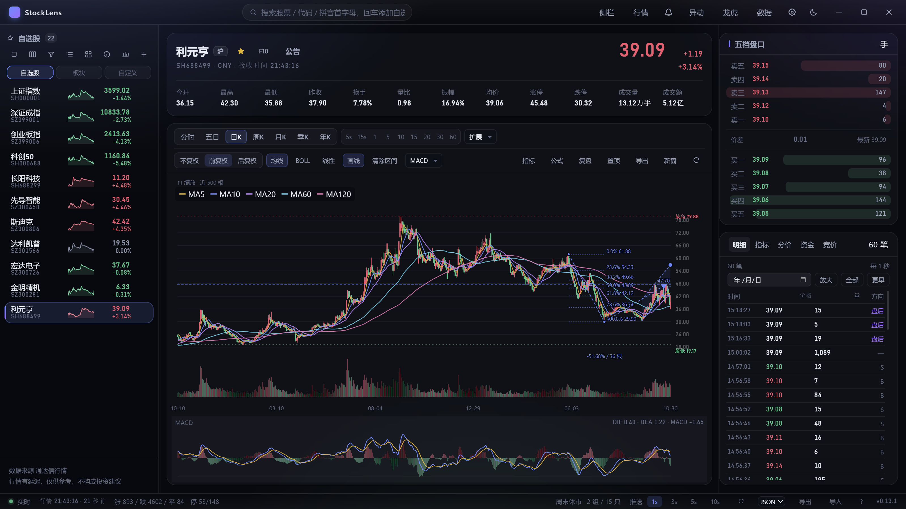
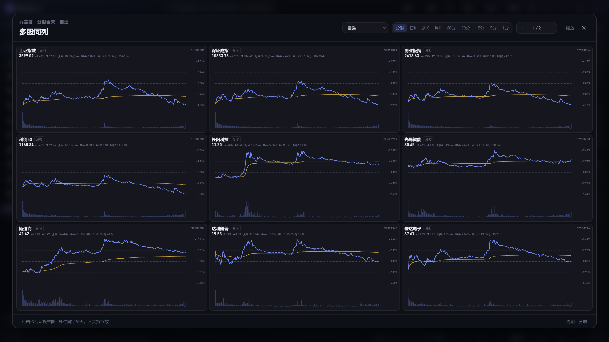
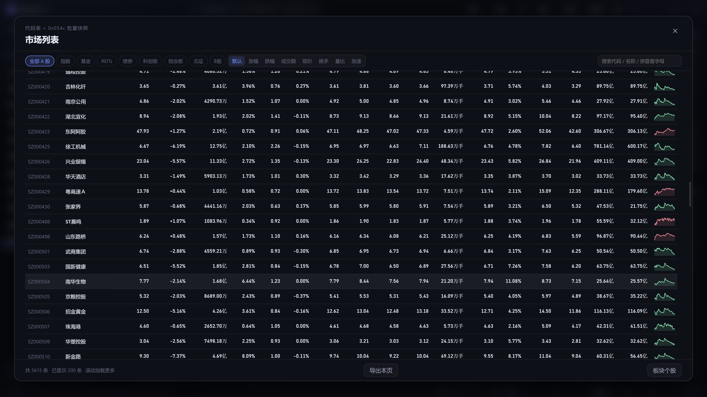
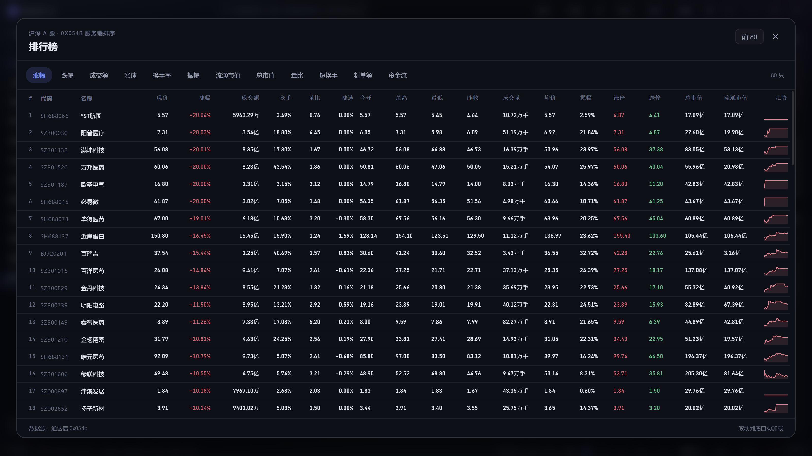
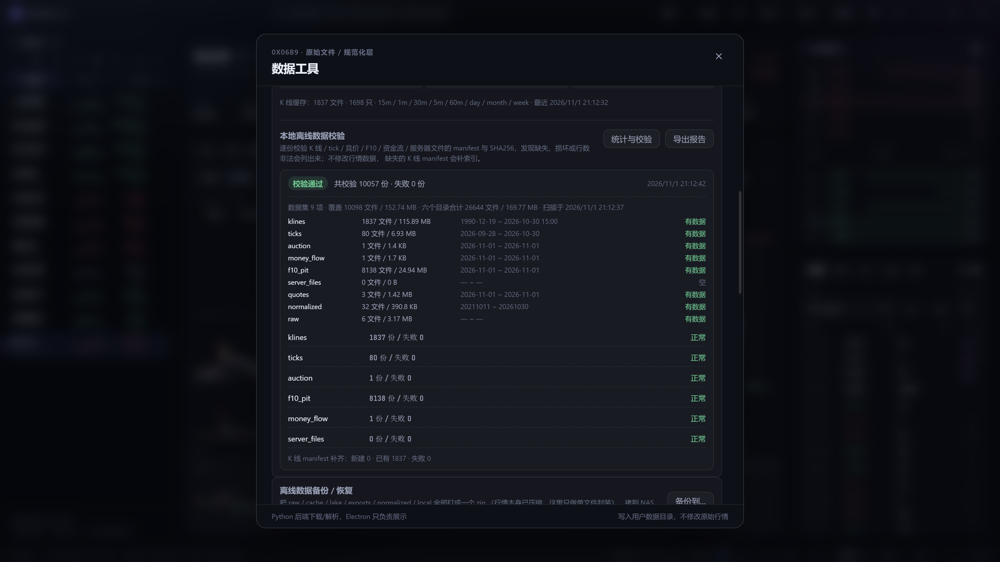

# StockLens · A 股行情终端

> **只做 A 股、只接通达信行情源**的跨平台行情终端。
> Electron 桌面端与浏览器 Web 端共用一套 SolidJS 界面；Python 负责通达信协议、
> 实时行情、离线数据与面向机器学习的数据湖。

`Electron` · `Vite` · `SolidJS` · `TypeScript` · `Python` · `通达信 7709 / MAC / 7615`

**版本：0.14.4（release candidate）** · **许可证：GPL-3.0-or-later** ·
`npm run check`：315 个 TS 测试 + 164 个 Python 测试（1 skipped）·
`npm run audit:data`：39/39。

> 0.14 而不是 1.0：`0x0547` 的盘中增量/推送语义仍需在交易时段复验。
> Windows x64 0.14.4 与 macOS arm64 0.14.4 已完成本机打包验证（macOS 仅散装 app + dmg，
> 不发布 Release）；Linux 0.14.0 已发布验收。Windows/Linux 0.14.4 的对外发布另行决定。
> macOS 只支持 Apple Silicon，不维护 Intel 版。
> 0.14.4 Windows 安装版 K 线首图约 0.35 秒、逐笔首行约 0.21 秒（本机实测），
> 并已用本机自签名证书做完整性签名（不改变 SmartScreen 提示）。

## 跨平台与验证环境

StockLens 是 **Windows / macOS / Linux 三平台**项目，代码同一套，构建和测试在对应
系统上原生进行，**不做交叉编译**。

| 平台    | 编译 / 测试环境     | 架构                  | 主要产物                                                       |
| ------- | ------------------- | --------------------- | -------------------------------------------------------------- |
| Windows | **Windows 10 22H2** | x64                   | NSIS 安装包、单文件便携版、win-unpacked（绿色 zip 需手工打包） |
| macOS   | **macOS 27.2**      | Apple Silicon / arm64 | 散装 `.app`、dmg                                               |
| Linux   | **Ubuntu 26.04.1**  | x64                   | AppImage、deb                                                  |

- macOS 只支持 Apple Silicon（M 系列），不维护 Intel/x64 版本；
- Windows / Linux 构建机需要 Python 3.10+ 与 Nuitka；macOS 需要 Xcode Command Line Tools；
- 发布产物在 `release/<version>/`；本机验证记录见 `docs/07`。

---

## 界面

### 主界面：K 线、盘口与自选



主图上方集中显示今开/最高/最低/昨收、换手、量比、振幅、均价、涨停/跌停；
右侧是五档盘口、逐笔/分价/竞价/资金流/指标页签；左栏自选股按添加顺序排列，
支持拖拽调整，多股同列会同步这个顺序。

### 多股同列：九宫格分时 / K 线，可翻页、可拖动排序



- 固定 3×3 九宫格，默认**分时全天**（240 个交易分钟固定横轴），也可切日/周/月/60/30/15/5/1 分；
- 每一格都有价格线、均价线、昨收基准、分钟量；
- 顶部数据行：名称/周期/现价/涨跌幅/涨跌额/现量/换手/量比/均价；
- 右侧刻度：分时只显示百分比，K 线只显示价格；
- 分时图有三道淡色时间线（10:30 / 11:30 / 14:00）；
- 自选/自定义超过 9 只自动分页（`‹ 1/2 ›`，左右方向键）；
- 卡片可直接拖动调整九格布局，点击卡片切主图。

### 全市场列表：20 列 + 滚动加载



代码/名称/现价/涨跌幅/成交额/换手/量比/涨速 + 今开/最高/最低/昨收/成交量/均价/
振幅/涨停/跌停/总市值/流通市值/迷你走势。默认窗口无横向滚动条，向下滚动自动加载。

### 排行榜与板块




排行榜复用同一套指标列；板块/概念左侧板块栏 + 成分股表，均支持迷你走势图按可见行懒加载。
垂直浏览已全部改为滚动，不再有上一页/下一页。

### F10：16 段目录、19 个在线页签


固定 1056px 阅读宽度，正文、表格、公告链接、GBK 原文按段落渲染；
最新提示里的单列框线段落保留换行，不再和表格最后一行混排。

### 数据工具：离线统计 + 全量校验报告



- 统计：9 类数据集文件数、大小、日期覆盖，六个目录合计；
- 校验：逐份校验 manifest + SHA256，当前数据 **1 万余份 / 0 失败**；
- 可导出 JSON 报告；备份恢复采用同名文件全量覆盖。

---

## 项目定位

这是一个**学习项目**，目标不是复刻商业行情软件，而是把下面几条链路走通：

- 通达信 7709 / MAC / 7615 真实协议与数据解析；
- 实时行情、K 线、逐笔、竞价、资金流、F10；
- 离线数据湖：Parquet + DuckDB，按 `trade_date` 分区，可追溯、可重放；
- 桌面与 Web 共用同一套界面；
- 财务/公告 point-in-time，给未来的数据挖掘和机器学习用；
- 代码、测试、数据审计能重复跑通。

**明确不做**：港股/美股/期货/期权/外汇、7727 扩展行情、Level-2/逐笔委托、
研报正文、交易下单、登录账户。协议拿不到或授权不允许的数据不会伪造。

---

## 功能概览

### 行情与图表

- 实时行情：通达信 7709 / MAC 批量快照，1 秒级刷新，价格跳变高亮；
- 分时 / 五日 / 多周期 K：5s、15s、1–60 分钟、2–45 日、日/周/月/季/年；
- 五档盘口、成交明细、分价表、集合竞价、资金流；
- K 线均线、BOLL、成交量、MACD/KDJ/RSI 等副图；
- 线性/对数坐标、缩放、平移、十字光标、区间统计；
- 画线：趋势线、水平线、垂直线、文字、斐波那契、测量、箭头、平行通道；
  吸附、拖动、复制粘贴、撤销/重做、按复权隔离、日期锚点持久化；
- 智能画线：Python 识别主摆动，生成常用组合；
- 多股同列、独立分时窗口、全屏自选、当前窗口置顶。

### 资料、选股与复盘

- F10：16 段目录、19 个在线页签，GBK 正文与表格渲染；
- 左栏「自选股 / 板块 / 自定义」三视图：
  - 自选股单层平铺，按添加顺序，支持拖拽排序；
  - 板块用大窗口选一级/二级行业、通达信行业、概念、风格、指数板块、一般；
  - 自定义板块单独管理，同样按添加顺序并可拖拽；
- 排行榜：涨幅/成交额/涨速/换手/量比/市值/资金流等；
- 条件选股、预设、自动股票池、公式选股、单标的/组合回测；
- 复盘：日 K 逐根、分时逐分钟、历史逐笔前进/回放；
- 个股列表右键菜单：加入自选或具名自定义板块；
- 离线数据单文件备份/恢复（恢复为全量覆盖）；备份和恢复都有真实字节/文件进度条，
  扫描、写入、SHA256、恢复阶段分开显示，备份路径可直接输入或通过对话框选择。

### 数据与工程

- **数据湖**：K 线/逐笔/资金流/竞价/F10 PIT/服务器文件清单；
- **存储**：Parquet + ZSTD，DuckDB 读写；数据分析使用 pandas/pyarrow/numpy，不进入 sidecar；
- **PIT**：F10/财务/公告查询自动快照，保存抓取时间、报告期、SHA256；
- **归档**：逐笔、竞价、资金流按 `trade_date` 分区；
- **下载**：日 K / 1 分钟 K / 逐笔，自选全量/市场全量，支持停止、失败清单、断点续跑；
- **审计**：`data_coverage` 覆盖九类数据，`data_integrity` 逐份校验 manifest/SHA256；
- **双前端**：桌面 Electron + Web，共用 `src/renderer` 和设计令牌；
- **质量门禁**：`npm run check`（类型/Lint/TS 测试/Python 测试）。

---

## 快速开始

### 环境

| 依赖                     | 版本                                          | 用途                                           |
| ------------------------ | --------------------------------------------- | ---------------------------------------------- |
| Node.js                  | ≥ 20.19（实测 24.22.2）                       | 前端与 Electron                                |
| Python                   | ≥ 3.10（实测 3.14.10）                        | 开发/Python 后端；打包后的桌面版不需要用户安装 |
| duckdb                   | ≥ 2                                           | Parquet 读写与查询                             |
| pyarrow / pandas / numpy | 最新稳定版                                    | 数据挖掘/ML，sidecar 不打包                    |
| Nuitka                   | 4.x（实测 4.3.4）                             | 构建 Python sidecar                            |
| OS / 工具链              | Windows 10 22H2 / macOS 27.2 / Ubuntu 26.04.1 | 原生编译，不做交叉编译                         |

```bash
npm install
python3 -m pip install -r requirements.txt
```

### 开发

```bash
npm run dev          # 桌面：Electron + Vite + Python 桥接
```

Web：

```bash
python3 python/tdx_server.py --port 8765
npm run dev:web
```

单端口托管 Web：

```bash
npm run build:web
python3 python/tdx_server.py --web-dir out/web --port 8765
```

## 快速编译手册

### 0. 通用准备

三平台都需要 **Node.js ≥ 20.19（实测 24.22.2）**、**Python ≥ 3.10（实测 3.14.10）**
和 **Nuitka 4.x（实测 4.3.4）**。先拉代码并安装依赖：

```bash
git clone https://github.com/riverzhou/pythontdx.git
cd pythontdx
npm install
python3 -m pip install -r requirements.txt
```

Windows 上 `python3` 换成 `py -3`，`npm` 换成 `npm.cmd`（PowerShell 执行策略限制时）。
打包脚本会自动先跑 `npm run build:python`，把 Python sidecar 编成单个可执行文件；
不需要用户机器安装 Python。

首次构建会下载 Electron 运行时与 NSIS 工具链；仓库 `.npmrc` 已配国内镜像，
网络环境不同时检查 `electron_mirror` 与 `electron_builder_binaries_mirror` 两个键
（详见 `docs/07` 2.3）。

提交/发版前先跑质量门禁：

```bash
npm run check        # 类型 + Lint + 315 TS + 164 Python
npm run audit:data   # 39 项数据覆盖/完整性审计
```

### 1. Windows 10 22H2（x64）

前置：Visual Studio 2022 Build Tools（Desktop development with C++，Nuitka 需要 MSVC）、
64 位 Python 3.10+、Node.js 20+。

```powershell
npm.cmd install
py -3 -m pip install -r requirements.txt
npm.cmd run check

npm.cmd run build:win            # NSIS 安装包 + 单文件便携版
npm.cmd run build:win:setup      # 只出安装包
npm.cmd run build:win:portable   # 只出便携版
```

`build:win` 在 `release/<version>/` 留下：

- `stocklens-<version>-setup.exe`：NSIS 安装包；
- `stocklens-<version>-portable.exe`：单文件便携版；
- `win-unpacked/`：Electron 解包目录，**绿色版原料**。`build:win` 不会自动改名，
  也不会自动压 zip；要交付散装绿色包/zip，复制后压缩：

```powershell
$v = node -p "require('./package.json').version"
$out = "release\$v"
Copy-Item "$out\win-unpacked" "$out\StockLens-$v-win-x64" -Recurse
Compress-Archive -Path "$out\StockLens-$v-win-x64" `
  -DestinationPath "$out\StockLens-$v-win-x64.zip"
# 或：& 'C:\Program Files\7-Zip\7z.exe' a -tzip -mx=9 `
#       "$out\StockLens-$v-win-x64.zip" "$out\StockLens-$v-win-x64"
```

> Windows 包使用**本机自签名证书**做完整性签名（`build:win` 会自动调用
> `npm run sign:win`）。首次构建会创建一张 10 年有效的代码签名证书，公钥导出到
> `release/<version>/stocklens-selfsigned.cer`。
>
> 它只保证文件签名后没有被改过，**不会消除 SmartScreen 的「未知发布者」**。
> 校验：
>
> ```powershell
> Get-AuthenticodeSignature release\<version>\stocklens-<version>-setup.exe |
>   Format-List Status, SignerCertificate
> ```
>
> `Status` 为 `UnknownError` 是正常的（自签名根未被系统信任）；`NotSigned` /
> `HashMismatch` 才说明文件没有有效签名或被改过。安装公钥后系统才会把发布者显示为
> `StockLens Self-Signed`。

### 2. macOS 27.2（Apple Silicon / arm64）

前置：Xcode Command Line Tools（`xcode-select --install`）、Node.js/Python 均为 arm64。
**只支持 Apple Silicon，不构建 Intel/x64 版本。**

```bash
npm install
python3 -m pip install -r requirements.txt
npm run check

npm run build:mac:app   # 只出散装 .app，最快验证
npm run build:mac:all   # 散装 .app + dmg
npm run build:mac       # 只出 dmg
```

产物：

```text
release/<version>/mac-arm64/StockLens.app
release/<version>/stocklens-<version>-arm64.dmg
```

macOS 首次启动会触发 Gatekeeper 对 sidecar 的安全扫描，**首屏约 10 秒**；之后同一
解包路径复用扫描结果，**约 0.36 秒**。本机 0.14.4 实测：

| 场景                                      |          到分时图 |
| ----------------------------------------- | ----------------: |
| 真首次（全新 userData + 清 sidecar 缓存） |      **10,333ms** |
| 第二次                                    |         **365ms** |
| 第三次 / 第四次                           | **364ms / 389ms** |

首次慢是 macOS 安全机制，不是 CPU/解包问题；详见 `docs/06` 第 42 条。首次之后
图表直接命中 localStorage 分时快照，并标「离线缓存」，网络回来覆盖。

> **macOS 安装（ad-hoc 签名、未公证）**：从浏览器下载后首次打开会被 Gatekeeper
> 拦截——点「完成」，到 系统设置 → 隐私与安全性 → 仍要打开；或在核对 SHA256 后执行
> `xattr -dr com.apple.quarantine /Applications/StockLens.app`。
> ad-hoc 不是可信任签名（`spctl -a` 仍拒绝），但整包签名完整
> （`codesign --verify --deep --strict` 通过）；详见 `docs/07` 第三十五节。

### 3. Ubuntu 26.04.1（x64）

前置：`build-essential`、`python3-dev`、`patchelf`；AppImage 运行还需要 FUSE
（deb 不需要）。

```bash
sudo apt install build-essential python3-dev patchelf
python3 -m pip install -r requirements.txt
npm run check

npm run build:linux   # AppImage + deb
```

产物在 `release/<version>/`：`StockLens-<version>.AppImage`、
`stocklens_<version>_amd64.deb`。AppImage 需要 `chmod +x` 后运行；
deb 可 `sudo dpkg -i` 或 `dpkg-deb -x` 解包直接运行。

### 4. 产物速查

| 平台        | 命令                    | 产物                                                             |
| ----------- | ----------------------- | ---------------------------------------------------------------- |
| Windows x64 | `npm run build:win`     | setup.exe / portable.exe / win-unpacked（绿色原料）              |
| macOS arm64 | `npm run build:mac:all` | `.app` + dmg                                                     |
| Linux x64   | `npm run build:linux`   | `StockLens-<version>.AppImage` + `stocklens_<version>_amd64.deb` |

三平台都**在本机原生构建，不做交叉编译**。每次版本更新后建议至少跑一次
`npm run build:mac:all`（macOS）或对应的 `build:win` / `build:linux`，并实际启动产物验证。

> **0.14.4 本地验证**：Windows setup / portable / 绿色包 / zip 已打包、逐个启动，
> 并用本机自签名证书签名（安装版 K 线 353ms、逐笔 209ms；绿色包 335ms / 184ms；
> 公钥在 `release/0.14.4/stocklens-selfsigned.cer`，SmartScreen 仍会提示未知发布者）；
> `release/0.14.4/mac-arm64/StockLens.app` 与 `release/0.14.4/stocklens-0.14.4-arm64.dmg`
> 也已构建、签名和 GPL 校验通过；dmg 只做本地验证，不发布 GitHub Release。

---

## 架构

```text
Electron 壳 ─┐
             ├── IPC / HTTP / SSE / WebSocket ── Python 后端 ── 通达信 7709 / MAC / 7615
浏览器 Web ──┘                                      │
                                                    ├── 本地数据湖（Parquet + DuckDB）
                                                    └── 通达信文件/本地文件
```

- 桌面与 Web 共用 `src/renderer`；
- Python 是唯一的行情 socket / 文件 IO 入口；
- 纯函数和类型放 `src/shared`，桌面/Web/Node 三端可编译；
- 技术分析识别放 Python，画线交互/渲染放 TS：
  `python/patterns.py` → `chart_patterns` → `KLineChart` 日期映射；
- 数据目录默认在用户数据目录下的 `data/`，结构见 [docs/12](docs/12-数据覆盖审计.md)。

---

## 数据与协议边界

| 数据                          | 状态                             |
| ----------------------------- | -------------------------------- |
| 实时五档、K 线、分时、逐笔    | ✅ 通达信 7709/MAC               |
| 竞价、资金流                  | ✅ `0x056a` / `0x0ffc`，本地归档 |
| F10 / 财务 / 公告             | ✅ 7709 + 7615，PIT 快照         |
| 日 K / 1 分钟 / 逐笔归档      | ✅ Parquet + DuckDB              |
| 服务器文件已知清单            | ✅ `zhb.zip` 47 文件及差分       |
| 服务器完整目录                | ⛔ 无目录枚举命令                |
| 历史五档 / Level-2 / 逐笔委托 | ⛔ 协议/授权边界                 |
| 研报正文                      | ⛔ 授权边界                      |
| 7727 / EX                     | ⛔ 非 A 股范围                   |
| `0x0547` 盘中增量/推送        | 🟡 待下一交易时段复验            |

不伪造数据；缺失数据在 UI 显示 `—`，并保留边界说明。

---

## 目录

```text
src/
├── main/          Electron 主进程、窗口、存储、行情门面
├── preload/       contextBridge 白名单桥
├── shared/        类型与纯函数（桌面/Web/Node 共享）
├── renderer/      SolidJS 界面：components / stores / lib / styles
└── web/           Web 入口与 HTTP API 客户端

python/
├── tdx_bridge.py  通达信桥接 + JSON Lines 命令
├── tdx_server.py  HTTP API / SSE / WebSocket
├── patterns.py    技术形态识别（可被 ML/回测直接 import）
├── f10_pit.py     F10/财务 point-in-time
├── parquet_store.py
├── tick_archive.py / auction_archive.py / flow_archive.py
├── data_coverage.py / data_integrity.py / server_catalog.py
├── test_*.py
└── fixtures/      真实报文

scripts/           截图、图标、探针、数据审计入口
docs/              目标、架构、协议、UI、路线图、发布、数据审计
screenshots/       本地验收截图（gitignore）
docs/assets/       README 截图
```

---

## 文档

| 文档                                                           | 内容                   |
| -------------------------------------------------------------- | ---------------------- |
| [docs/00-项目章程.md](docs/00-项目章程.md)                     | 目标、范围与非目标     |
| [docs/01-快速开始.md](docs/01-快速开始.md)                     | 环境与命令             |
| [docs/02-架构设计.md](docs/02-架构设计.md)                     | 桌面/Web/Python 架构   |
| [docs/03-通达信行情手册.md](docs/03-通达信行情手册.md)         | 7709 帧与字段          |
| [docs/04-UI设计系统.md](docs/04-UI设计系统.md)                 | 设计令牌与布局         |
| [docs/05-开发路线图.md](docs/05-开发路线图.md)                 | 里程碑                 |
| [docs/06-踩坑笔记.md](docs/06-踩坑笔记.md)                     | 实际踩坑               |
| [docs/07-手动编译发布手册.md](docs/07-手动编译发布手册.md)     | 构建/发布/验收         |
| [docs/08-通达信资料索引.md](docs/08-通达信资料索引.md)         | 协议资料来源           |
| [docs/09-官方客户端功能清单.md](docs/09-官方客户端功能清单.md) | 功能矩阵               |
| [docs/12-数据覆盖审计.md](docs/12-数据覆盖审计.md)             | 数据清单、schema、审计 |
| [docs/13-技术分析算法.md](docs/13-技术分析算法.md)             | Python/TS 算法边界     |

工程规则见 [AGENTS.md](AGENTS.md)、[PRINCIPLES.md](PRINCIPLES.md)、
[PLAN.md](PLAN.md) 和 [CHANGELOG.md](CHANGELOG.md)。

---

## 许可证

本项目采用 **GNU General Public License v3.0 or later**（GPL-3.0-or-later）。
完整条款见 [LICENSE](LICENSE)。

## 免责声明

本项目是学习项目，行情数据来自通达信社区逆向协议，**不构成投资建议**，
不保证数据实时性、完整性或适用于交易。请遵守数据源服务条款，不要用于
商业转售、绕过授权或高频滥用。
